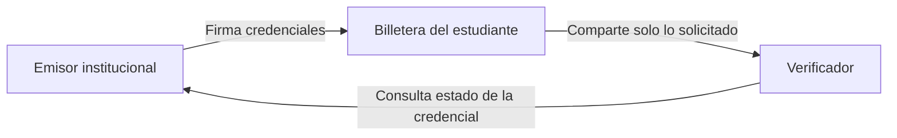
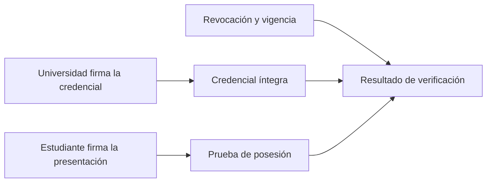
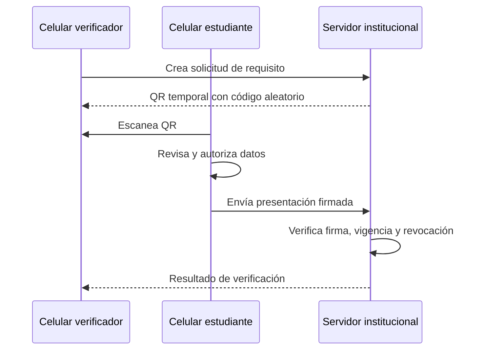
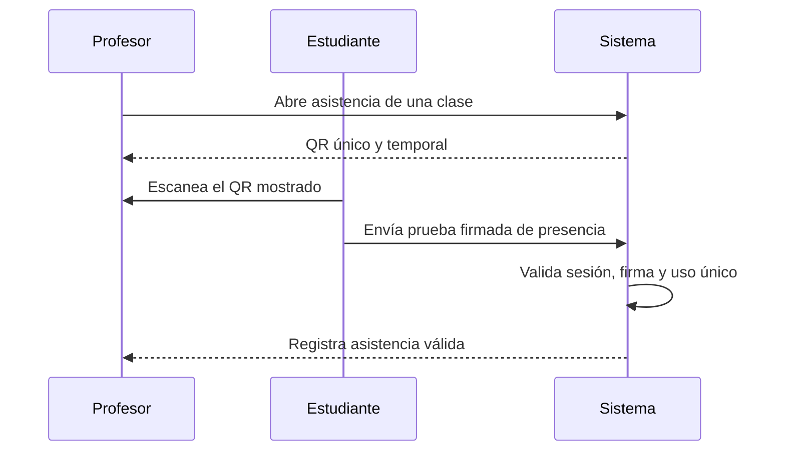

# Plan de implementación: Billetera Universitaria Verificable

## Propuesta de proyecto

**Título:** Diseño e implementación de una billetera universitaria de credenciales verificables para antecedentes académicos, asistencia y acceso a servicios institucionales.

**Objetivo:** permitir que un estudiante demuestre antecedentes académicos, registre asistencia y acredite acceso a servicios universitarios, compartiendo solo la información solicitada y con una firma digital verificable.

El sistema sigue el modelo de tres actores de las credenciales verificables: un emisor institucional crea la credencial, el estudiante la conserva como titular y un tercero verifica su autenticidad.

El proyecto no requiere blockchain ni criptomonedas. La autenticidad se logra con firmas digitales, claves públicas y un registro de credenciales revocadas.

---

## 1. Alcance del primer nivel

La primera versión será completamente funcional y demostrable con datos ficticios. Se emitirán cinco tipos de credencial:

| Credencial | Ejemplo |
|---|---|
| Regularidad | “Es alumno regular de Ingeniería en Sistemas de Información hasta diciembre de 2026”. |
| Materia aprobada | “Aprobó Algoritmos y Estructuras de Datos el 10/12/2025”. |
| Nota de materia | “Obtuvo 8 en Bases de Datos”. |
| Biblioteca | “Tiene membresía de biblioteca activa hasta el 31/12/2026”. |
| Gimnasio | “Tiene acceso al gimnasio universitario habilitado hasta el 31/12/2026”. |

Cada credencial será independiente. Si un verificador solo necesita comprobar que el estudiante aprobó una materia, recibirá esa credencial y no el historial académico entero ni otras notas.

### Casos de uso de la demostración

- Una materia correlativa solicita comprobar que el estudiante aprobó otra materia.
- Una beca solicita condición de alumno regular.
- Una práctica profesional solicita acreditar que se aprobó Bases de Datos.
- Un trámite solicita la nota de una materia puntual.
- La biblioteca comprueba que el estudiante tiene acceso vigente.
- El gimnasio universitario comprueba que la membresía se encuentra habilitada.
- Un profesor abre una sesión de asistencia y registra presencias mediante un QR temporal.
- El emisor revoca una credencial y el verificador la rechaza.
- Se altera una credencial manualmente y el verificador detecta que la firma dejó de ser válida.

---

## 2. Actores y arquitectura conceptual

| Actor | Función |
|---|---|
| Emisor institucional | Crea, firma y revoca credenciales académicas. |
| Estudiante | Guarda las credenciales en su billetera y decide cuándo presentarlas. |
| Verificador | Solicita una evidencia concreta y comprueba su validez; puede ser una materia, beca, biblioteca o gimnasio. |
| Profesor | Abre una sesión de asistencia y consulta las presencias registradas. |

Para el prototipo, el emisor será una universidad ficticia y se trabajará exclusivamente con registros académicos de prueba. Una futura integración podría leer datos desde una API institucional o importar un archivo CSV.

La cadena de confianza tiene dos partes: la universidad firma el contenido de la credencial y el estudiante firma cada presentación con la clave de su billetera. La primera firma protege el dato académico; la segunda demuestra que la presentación proviene de una billetera autorizada y fue creada para esa solicitud.

---

## 3. Datos de una credencial

Cada credencial incluirá como mínimo:

- Identificador único.
- Tipo de credencial.
- Emisor institucional.
- Identificador criptográfico del estudiante.
- Materia y código, cuando aplique.
- Atributos específicos: regularidad, aprobación, nota, membresía de biblioteca o membresía de gimnasio.
- Fecha de emisión y, si corresponde, de vencimiento.
- Estado de revocación.
- Firma digital del emisor.

Ejemplo conceptual de una credencial de aprobación:

    Tipo: AcademicCourseCredential
    Emisor: Universidad Demo
    Titular: identificador público del estudiante
    Materia: Bases de Datos
    Código: ISI-302
    Condición: aprobada
    Fecha de aprobación: 2025-12-10
    Estado: activa
    Firma: firma digital de Universidad Demo

La estructura se inspirará en el estándar [Verifiable Credentials Data Model v2.0 del W3C](https://www.w3.org/TR/vc-data-model/), que define el modelo emisor, titular y verificador para credenciales verificables.

---

## 4. Flujo de emisión

1. El emisor selecciona un registro académico ficticio.
2. El sistema construye la credencial correspondiente.
3. El emisor firma la credencial con su clave privada.
4. El sistema genera un QR temporal de entrega.
5. El estudiante escanea el QR desde su billetera.
6. La credencial llega al celular y queda almacenada localmente.

El servidor institucional conserva el registro mínimo de emisión y revocación. La billetera conserva la copia que el estudiante utilizará para presentar evidencia.

---

## 5. Flujo de verificación con dos celulares

1. El verificador abre la aplicación y elige el requisito. Por ejemplo: “Aprobó Bases de Datos”.
2. El sistema genera un QR temporal.
3. El estudiante escanea ese QR desde su billetera.
4. La billetera muestra con claridad qué información se solicita.
5. El estudiante selecciona una credencial compatible y acepta o rechaza compartirla.
6. La billetera envía una presentación firmada.
7. El verificador recibe el resultado.

El QR no llevará datos académicos. Contendrá un identificador de solicitud, el destinatario de la presentación, un código aleatorio de un solo uso y una fecha de vencimiento corta.

Antes de aceptar una presentación, el estudiante verá una pantalla similar a esta:

    El sistema “Correlativas 2026” solicita:
    - Materia: Bases de Datos
    - Dato requerido: condición de aprobación

    Se compartirá:
    - “Bases de Datos: aprobada”

    [Rechazar] [Compartir]

---

## 6. Módulo de asistencia con QR temporal

La asistencia será un caso de uso distinto, pero utilizará la identidad criptográfica ya existente en la billetera. No se usará un QR fijo del estudiante, ya que podría fotografiarse o reenviarse.

El profesor abrirá una sesión de asistencia para una comisión, clase y horario determinados. La aplicación mostrará un QR único, con vencimiento breve. Cada estudiante presente lo escaneará desde su billetera y autorizará el envío de una prueba firmada de presencia.

Cada QR estará ligado a una sesión concreta, tendrá un código aleatorio, expirará en uno o dos minutos y no podrá usarse nuevamente. El profesor podrá cerrar la sesión y consultar el listado de presentes.

La asistencia no requiere revelar notas, materias aprobadas ni credenciales de servicios. El sistema solo registrará la identidad académica mínima necesaria, la sesión y el momento de registro.

### Límite de seguridad de la asistencia

El QR no demuestra por sí solo que la persona física titular de la billetera estuvo en el aula. Una persona podría prestar un celular desbloqueado, compartir su PIN o registrar la asistencia por otra persona. Por eso, el proyecto debe describir este módulo como un registro de presencia verificable que reduce suplantaciones, no como una prueba absoluta de presencia física.

Para elevar la dificultad de fraude se incorporarán:

- Passkey, biometría o desbloqueo seguro antes de confirmar la asistencia.
- QR con vencimiento de 30 a 60 segundos y uso único.
- Asociación de la sesión con materia, comisión, aula, fecha y horario.
- Rechazo de una segunda asistencia de la misma billetera en la sesión.
- Revisión del listado por parte del profesor.

Controles como ubicación, Bluetooth o reconocimiento facial pueden estudiarse como extensiones, pero no garantizan por sí solos que el titular esté presente y agregan costos y riesgos de privacidad.

---

## 7. Validaciones realizadas por el verificador

La aplicación deberá validar:

1. Que el emisor forme parte de la lista de emisores confiables.
2. Que la firma digital del emisor sea correcta.
3. Que la credencial esté asociada a quien la presenta.
4. Que la credencial no esté vencida.
5. Que no esté revocada.
6. Que cumpla el requisito solicitado.
7. Que el QR no haya vencido ni se haya utilizado anteriormente.

El uso de un código aleatorio único y el vínculo con el verificador evita que una presentación capturada pueda reutilizarse. Esta decisión sigue el principio de prevención de ataques de repetición contemplado por [OpenID for Verifiable Presentations 1.0](https://openid.net/specs/openid-4-verifiable-presentations-1_0.html).

---

## 8. Stack tecnológico

| Capa | Tecnología propuesta | Uso |
|---|---|---|
| Interfaz | React + TypeScript | Pantallas de emisor, billetera y verificador. |
| Aplicación móvil | Progressive Web App (PWA) | Instalación en celulares sin publicar en una tienda. |
| Backend | Node.js + Fastify | API, emisión, validación y revocación. |
| Base de datos | SQLite; PostgreSQL como alternativa de despliegue | Registros académicos ficticios, emisiones y estado. |
| Firma digital | Ed25519 o P-256 mediante Web Crypto y JOSE | Firmar y verificar credenciales. |
| QR | qrcode y ZXing | Generar y escanear solicitudes y entregas. |
| Persistencia local | IndexedDB | Conservar la billetera y sus credenciales en el celular. |
| Protección de acceso | PIN local y, como mejora, passkeys | Evitar acceso casual a la billetera. |
| Pruebas unitarias | Vitest | Validar reglas y criptografía. |
| Pruebas de interfaz | Playwright | Verificar los recorridos completos. |
| Ejecución reproducible | Docker Compose | Levantar el sistema de forma consistente. |

La primera versión utilizará una API propia de presentación con QR. El diseño dejará preparada una futura migración hacia OpenID4VP para ganar interoperabilidad con billeteras externas.

---

## 9. Módulos de software

| Módulo | Responsabilidad |
|---|---|
| Panel del emisor | Cargar datos de prueba, emitir credenciales y revocarlas. |
| Billetera del estudiante | Recibir, guardar, consultar y presentar credenciales. |
| Verificador | Crear solicitudes, mostrar QR y visualizar el resultado. |
| Asistencia | Crear sesiones de clase, generar QR temporal y registrar presencias firmadas. |
| Servicio criptográfico | Firmar credenciales y comprobar integridad y autoría. |
| Servicio de estado | Informar si una credencial está activa, vencida o revocada. |
| Auditoría | Registrar emisiones, revocaciones y resultados mínimos de verificación. |

### Modelo de datos inicial

    issuers
    - id
    - nombre
    - clave_publica
    - estado

    academic_records
    - id
    - estudiante
    - carrera
    - materia
    - codigo_materia
    - condicion
    - nota
    - fecha

    credentials
    - id
    - tipo
    - emisor_id
    - titular_id
    - resumen_de_datos
    - hash
    - emitida_en
    - vence_en
    - estado

    presentation_requests
    - id
    - verificador
    - requisitos
    - codigo_aleatorio
    - vence_en
    - estado

    verification_events
    - id
    - solicitud_id
    - resultado
    - motivo
    - fecha

    attendance_sessions
    - id
    - profesor_id
    - materia
    - comision
    - inicia_en
    - vence_en
    - estado

    attendance_records
    - id
    - sesion_id
    - estudiante_id
    - registrada_en
    - prueba_firmada

La clave privada del emisor no se almacenará en la base de datos ni se enviará al navegador. Solo estará disponible en la configuración protegida del servidor.

---

## 10. Requisitos funcionales

### Emisor

- Cargar registros académicos ficticios.
- Emitir credenciales de regularidad, aprobación, nota, biblioteca y gimnasio.
- Generar un QR de entrega de credencial.
- Revocar una credencial.
- Consultar el historial de emisiones y revocaciones.

### Estudiante

- Instalar la billetera como PWA.
- Recibir una credencial mediante QR.
- Consultar las credenciales recibidas.
- Ver qué campos se solicitan antes de compartirlos.
- Aceptar o rechazar una presentación.
- Consultar un historial local de presentaciones.
- Registrar asistencia escaneando un QR temporal de una sesión abierta.

### Verificador

- Elegir el requisito solicitado: académico, biblioteca o gimnasio.
- Indicar una o varias materias necesarias.
- Generar un QR temporal.
- Recibir el resultado: válido, vencido, revocado, adulterado o insuficiente.
- Ver los campos exactos recibidos.

### Profesor

- Crear una sesión de asistencia para materia, comisión y horario.
- Mostrar un QR temporal para la sesión.
- Consultar las presencias registradas.
- Cerrar la sesión cuando termine el período de asistencia.

---

## 11. Requisitos de privacidad y seguridad

- Las credenciales estarán firmadas digitalmente.
- Cada presentación estará vinculada a una solicitud y un destinatario concretos.
- Los QR vencerán en pocos minutos y se usarán una sola vez.
- Los QR de asistencia estarán asociados a una sesión, comisión y ventana horaria específica.
- Una misma billetera no podrá registrar asistencia dos veces en la misma sesión.
- Una credencial revocada deberá rechazarse siempre.
- Una modificación de los datos deberá invalidar la firma.
- El estudiante deberá aceptar expresamente cada presentación.
- La pantalla de confirmación deberá mostrar todos los datos que se compartirán.
- La demostración utilizará datos ficticios.
- La prueba en celulares requerirá HTTPS para utilizar cámara, PWA y APIs criptográficas del navegador.

Este prototipo no debe presentarse como un sistema listo para administrar datos académicos reales sin una auditoría de seguridad, política institucional de privacidad y revisión legal.

---

## 12. Modelo de amenazas y límites

Las firmas digitales protegen la integridad y la autoría de los datos, pero no resuelven todos los problemas institucionales. Si la universidad emite una nota incorrecta o un operador autorizado actúa de forma indebida, la firma seguirá siendo técnicamente válida. La fuente emisora debe aplicar sus propios controles administrativos.

| Riesgo | Ejemplo | Control del prototipo |
|---|---|---|
| Modificación de una credencial | Cambiar una nota de 6 a 10. | Firmar toda la credencial y rechazar cualquier firma inválida. |
| Credencial inventada | Crear un JSON o PDF que parezca oficial. | Verificar firma y lista de emisores confiables. |
| Robo de la clave institucional | Un atacante firma credenciales falsas. | Clave privada solo en el servidor, rotación, revocación y auditoría. |
| Emisión indebida | Un operador emite una nota falsa. | Roles separados, registro de emisiones y aprobación adicional para operaciones sensibles. |
| Credencial revocada | Usar una constancia anulada. | Consulta de estado en cada verificación. |
| Reutilización de una presentación | Reenviar una prueba válida. | Código aleatorio, destinatario, vencimiento y uso único. |
| Robo o préstamo de billetera | Otra persona presenta credenciales ajenas. | Clave local protegida con PIN o passkey y vinculación de la presentación a la clave del titular. |
| QR malicioso | Un atacante pide datos innecesarios. | Mostrar solicitante y campos antes de compartir; exigir consentimiento. |
| Verificador abusivo | Biblioteca solicita notas o historial completo. | Requisitos permitidos por tipo de servicio y divulgación mínima. |
| Pérdida del dispositivo | Se pierde el celular con la billetera. | Bloqueo local, revocación de la clave y recuperación mediante nueva billetera. |
| Filtración de datos | Se expone el historial académico. | Guardar el mínimo necesario, cifrar secretos y no conservar presentaciones completas. |
| Falla del servidor | No se puede consultar revocación. | Mostrar estado “no verificable” y no aceptar silenciosamente la credencial. |
| Vulnerabilidad de dependencias | Una biblioteca compromete la aplicación. | Versiones fijadas, revisión de dependencias y pruebas de seguridad antes de desplegar. |

El núcleo asegura integridad, autenticidad y trazabilidad criptográfica de las credenciales. No garantiza por sí mismo que la persona que sostiene el celular sea el estudiante ni que el dato académico original haya sido correctamente cargado por la institución.

---

## 13. Etapas de desarrollo

### Estado del prototipo al 20 de octubre de 2026

Ya está implementada la primera versión del flujo entre dispositivos:

- El emisor firma las credenciales con Ed25519 en la API y conserva la clave privada en `data/`.
- La entrega por QR vence a los diez minutos y se puede reclamar una sola vez.
- La billetera valida y guarda credenciales y claves de dispositivo en IndexedDB.
- La primera recepción vincula el identificador ficticio del estudiante con esa billetera.
- La verificación usa una solicitud QR de un solo uso, consentimiento del estudiante, prueba firmada de posesión, revisión de vigencia y consulta de revocación.
- La asistencia usa QR temporal, firma de la billetera, control de duplicados y listado de presentes.
- El front end tiene manifiesto PWA y lector de cámara, que requiere HTTPS en Android.

La compilación y el análisis estático pasan. Queda pendiente probar la secuencia real con dos Android, obtener una URL HTTPS temporal para la cámara y registrar la evidencia de la demostración. Esta versión es académica: el estudiante tiene un identificador fijo de prueba, la primera recepción vincula el dispositivo y los roles del emisor, profesor y verificador todavía no requieren inicio de sesión. No cargar información real.

| Etapa | Entregable | Criterio de finalización |
|---|---|---|
| 1. Análisis y diseño | Casos de uso, modelo de datos, esquemas de credenciales y pantallas. | Los requisitos de cada actor están aprobados. |
| 2. Base del sistema | Backend, base de datos, datos ficticios y roles. | La aplicación levanta con datos de prueba. |
| 3. Emisión | Panel institucional, firma digital y QR de entrega. | Una billetera puede recibir una credencial válida. |
| 4. Billetera | PWA, IndexedDB, listado y detalle de credenciales. | Las credenciales persisten luego de cerrar la app. |
| 5. Verificación | Solicitudes, QR, presentación y resultado. | Dos dispositivos completan una verificación válida. |
| 6. Servicios y asistencia | Credenciales de biblioteca y gimnasio; sesiones de asistencia con QR. | Se verifica un acceso y se registra una presencia desde dos celulares. |
| 7. Revocación y ataques | Revocación, expiración y controles de reutilización. | Los escenarios inválidos se rechazan correctamente. |
| 8. Pruebas y documentación | Suite de pruebas, manual y evidencia de demo. | El proyecto puede instalarse y demostrarse de forma repetible. |

---

## 14. Plan de pruebas

| Caso | Resultado esperado |
|---|---|
| Credencial válida y activa | Se acepta. |
| Credencial con datos alterados | Se rechaza por firma inválida. |
| Materia distinta a la requerida | Se rechaza por requisito no satisfecho. |
| Credencial vencida | Se rechaza. |
| Credencial revocada | Se rechaza. |
| QR vencido | Se rechaza. |
| QR usado por segunda vez | Se rechaza. |
| Solicitud de aprobación | Se comparte la condición, sin la nota. |
| Solicitud de nota | Se comparte únicamente la nota de esa materia. |
| Solicitud rechazada por el estudiante | El verificador no recibe datos. |
| Credencial de biblioteca vigente | Se permite el acceso. |
| Credencial de gimnasio revocada o vencida | Se rechaza el acceso. |
| Asistencia con QR vigente | Se registra una única presencia válida. |
| Asistencia con QR vencido | Se rechaza el registro. |
| Segundo intento en la misma sesión | Se rechaza como duplicado. |
| Presentación firmada con una clave distinta | Se rechaza por falta de prueba de posesión. |
| QR de asistencia fuera de horario | Se rechaza. |
| Billetera bloqueada antes de presentar | No se comparte información. |
| Solicitud con campos no permitidos | Se advierte o se rechaza. |

### Métricas para la evaluación académica

- Porcentaje de credenciales válidas aceptadas.
- Porcentaje de credenciales inválidas rechazadas.
- Tiempo promedio de verificación.
- Cantidad de campos compartidos frente a los disponibles en la billetera.
- Cantidad de ataques simulados bloqueados.

---

## 15. Demostración con dos celulares

### Equipo necesario

- Un celular para la billetera del estudiante.
- Un celular para el verificador.
- Una computadora o tercer dispositivo para el panel del emisor durante la etapa de emisión.
- Conexión a una instancia HTTPS de prueba.

### Secuencia sugerida

1. Desde el panel institucional se emite una credencial de “Bases de Datos aprobada”.
2. El celular del estudiante escanea el QR de emisión y guarda la credencial.
3. El segundo celular crea una solicitud de “Bases de Datos aprobada”.
4. El estudiante escanea el QR del verificador.
5. La billetera muestra el dato solicitado y pide autorización.
6. El estudiante acepta.
7. El segundo celular muestra que la credencial es válida.
8. Se revoca la credencial desde el panel institucional.
9. Se repite la presentación y el verificador la rechaza.
10. El profesor abre una asistencia desde el segundo celular y muestra su QR.
11. El celular del estudiante lo escanea y registra su presencia firmada.
12. Se intenta registrar nuevamente la misma asistencia y el sistema la rechaza.

---

# Ampliación al segundo nivel: divulgación mínima

El segundo nivel busca responder consultas como:

- “¿Tiene promedio mayor o igual a 7?”
- “¿Aprobó al menos 20 materias?”
- “¿Obtuvo una nota mayor o igual a 8?”
- “¿Cumple las correlativas sin revelar todas sus notas?”

## Nivel 2A: credenciales derivadas — ampliación recomendada

El emisor puede crear credenciales que contienen condiciones, en lugar del valor exacto:

    Promedio mayor o igual a 7: sí
    Cantidad de materias aprobadas mayor o igual a 20: sí
    Nota de Bases de Datos mayor o igual a 8: sí

El estudiante comparte la condición firmada por la institución sin revelar el promedio o nota exactos. Esta alternativa es viable para incorporar después del primer nivel y conserva la demostración simple.

## Nivel 2B: divulgación selectiva

Una misma credencial puede tener varios atributos, pero la billetera revela solo los necesarios. Por ejemplo, comparte materia y condición de aprobación, ocultando nota, carrera y fecha.

Esta etapa puede usar un formato compatible con SD-JWT VC y el protocolo OpenID4VP. Requiere más trabajo de interoperabilidad y pruebas de seguridad.

## Nivel 2C: pruebas criptográficas de condiciones

El sistema demostraría matemáticamente que una condición se cumple sin revelar el valor. Por ejemplo, que una nota es mayor o igual a 7 sin mostrar la nota.

Es una extensión de investigación valiosa, pero no debe ser un requisito para completar el proyecto: implica criptografía más compleja, bibliotecas especializadas y una evaluación adicional.

---

## Resultado esperado

Al finalizar el primer nivel, el proyecto permitirá emitir, guardar, presentar, verificar y revocar credenciales académicas firmadas. La arquitectura permitirá ampliar el sistema hacia una divulgación más privada de condiciones académicas, sin rehacer los módulos principales.
